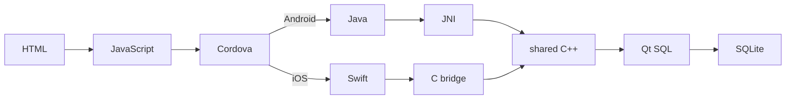

# sqlite-qt-poc

The same screen calls the same Qt SQL demonstration on Android and iOS. It creates a SQLite database in app-private storage, writes a message, closes the database, reopens it read-only and displays the stored message.

## Follow the code



| Layer | Source | Responsibility |
| --- | --- | --- |
| Screen | [HTML](www/index.html), [JavaScript](www/js/index.js) | Run the demonstration and show the result |
| Cordova bridge | [SqlitePoc.js](native-plugin/www/SqlitePoc.js) | Send `run` to the platform plugin |
| Android | [Java](native-plugin/src/android/SqlitePoc.java), [JNI](native-plugin/src/android/SqlitePoc.cpp) | Choose the database path and call C++ |
| iOS | [Swift](native-plugin/src/ios/SqlitePoc.swift), [C bridge](native-plugin/src/ios/SqlitePocBridge.cpp) | Choose the database path and call C++ |
| Both platforms | [SqliteDemo.cpp](native-plugin/src/shared/SqliteDemo.cpp) | Create, write, close, reopen and read using Qt's QSQLITE driver |

Android loads the Qt SQLite driver as a library. On iOS, Qt and the driver are linked into the app. The bridge's C interface lets Swift call the shared C++ without exposing Qt types to Swift.

## Android on Windows

Requires Python 3.10+ (64-bit), JDK 21, Node.js 24 with npm, Cordova CLI and Android SDK 36 with platform-tools and command-line tools. Set `JAVA_HOME` and `ANDROID_HOME`.

```powershell
./build.ps1
cordova run android --device
```

The build script prepares its Qt/C++ tools and creates a debug APK. A connected, authorized Android device is required to run it.

## iOS simulator on an Apple Silicon Mac

Requires Xcode with an iOS simulator, nvm and Python 3.13. Run these commands from the project directory.

One-time setup:

```bash
nvm install 24
nvm use 24
bash setup-ios.sh
```

Setup downloads and builds Qt and can take several minutes.

Build and open the app:

```bash
nvm use 24
bash build-ios.sh
npx cordova run ios --emulator --nobuild --target="iPhone-17-Pro, 26.2"
```

For another iPhone or iPad, run `npx cordova run ios --list` and choose a target running iOS 18 or newer.

Setup was tested on the Mac Mini in our server room.
